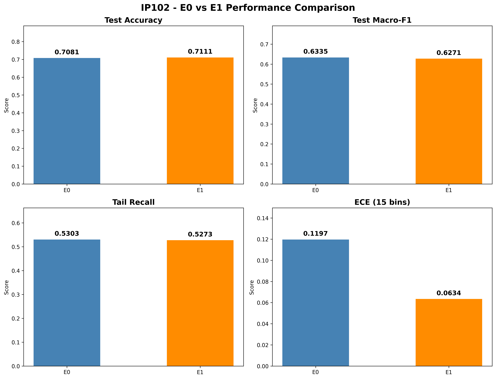
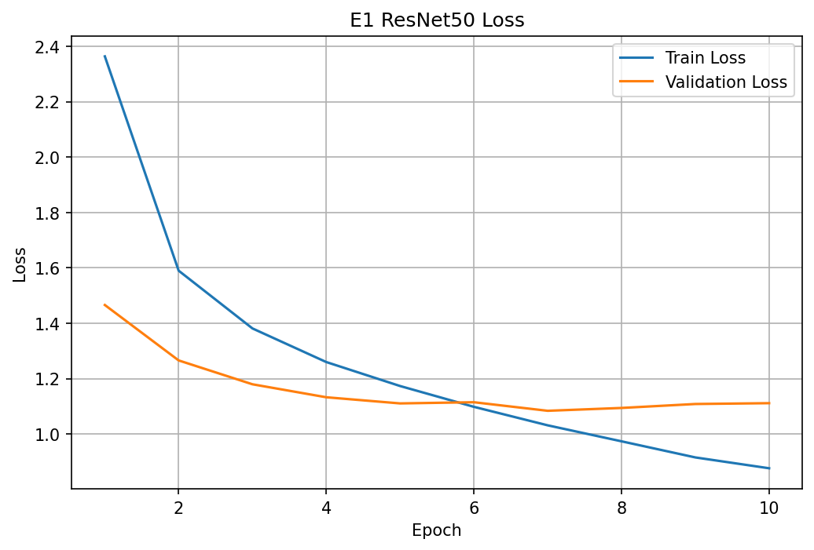
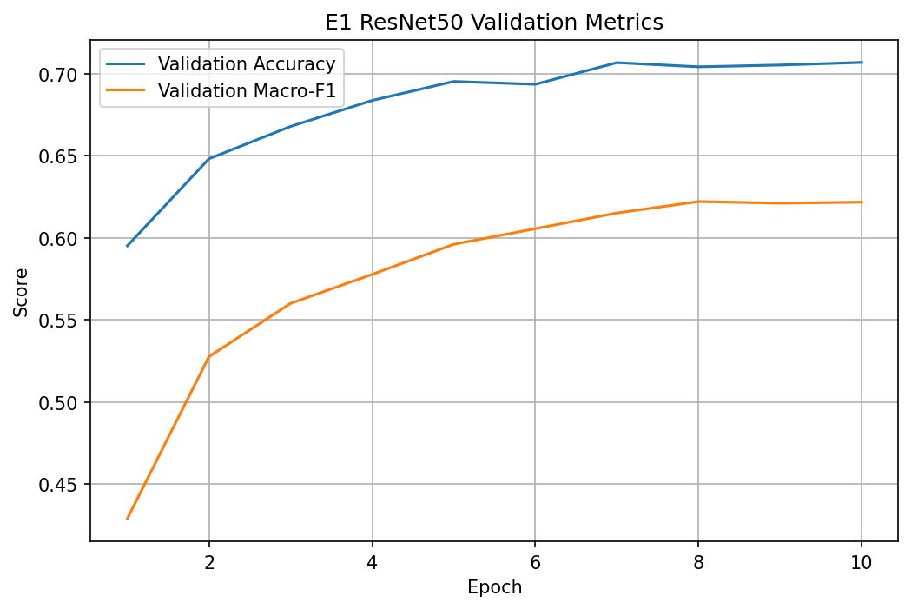
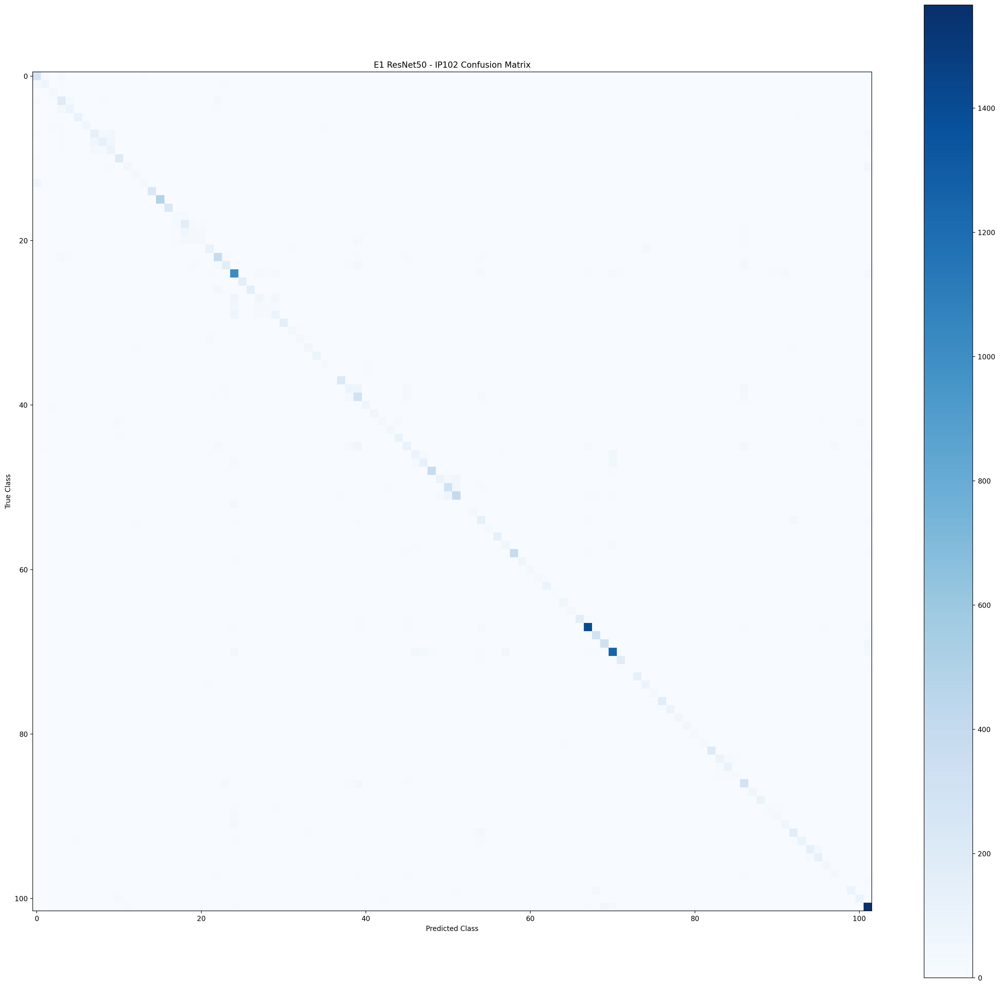

# Targeted Training Data Cleaning for Pest Classification on IP102

## Project Overview

This research investigates the impact of targeted training data
cleaning on pest image classification performance, with a
particular focus on minority classes.

We use the IP102 dataset and an ImageNet-pretrained ResNet50
model to compare different training data cleaning strategies.

## Dataset

- Dataset: IP102
- Number of classes: 102
- Total images: 75,222
- Training images: 45,095
- Validation images: 7,508
- Test images: 22,619

## Experimental Design

| Experiment | Strategy |
|------------|----------|
| E0 | Baseline (no data removal) |
| E1 | Random 5% training data removal |
| E2 | Highest-loss 5% removal |
| E3 | Lowest-confidence 5% removal |
| E4 | Class-protected high-loss removal |

## Baseline Results (E0)

| Metric | Result |
|--------|--------|
| Test Accuracy | 70.81% |
| Test Macro-F1 | 63.35% |
| Tail-Class Recall | 53.03% |
| Expected Calibration Error (ECE) | 0.1197 |

Model: ResNet50 (ImageNet pretrained)

Best checkpoint: Epoch 9

## Project Progress

- [x] Week 1: Literature review and experimental planning
- [x] Week 2: Dataset exploration and integrity checks
- [x] Week 3: Baseline training and evaluation
- [ ] Week 4: Training sample loss and confidence analysis
- [ ] Week 5: Data cleaning experiments
- [ ] Week 6: Comparative analysis and final report

## Evaluation Metrics

- Classification Accuracy
- Macro-F1 Score
- Tail-Class Recall
- Expected Calibration Error (ECE)

## Computing Environment

- Google Colab
- NVIDIA Tesla T4 GPU
- PyTorch
- ResNet50

## Project Status

The baseline experiment (E0) has been completed.
The next stage focuses on identifying potentially
problematic training samples using loss and confidence scores.

---

## E0 vs E1 — Experimental Results

Both experiments were evaluated on the IP102 test set containing
22,619 images across 102 agricultural pest classes.

### Performance Comparison

| Metric | E0 | E1 (ResNet50) | Better |
|---|---:|---:|---|
| Test Accuracy | 70.81% | **71.11%** | E1 |
| Test Macro-F1 | **63.35%** | 62.71% | E0 |
| Tail Recall | **53.03%** | 52.73% | E0 |
| ECE (15 bins) | 0.119675 | **0.063392** | E1 |

**Key findings:**

- E1 achieved slightly higher overall test accuracy.
- E0 achieved slightly higher Macro-F1 and Tail Recall.
- E1 achieved lower Expected Calibration Error (ECE).
- The ECE comparison assumes identical evaluation procedures.

### Performance Visualization

### E1 Training Curves

**Training Loss**

**Training Metrics**

### E1 Confusion Matrix

### Experiment Reports

- [Week 01 — Research Plan](reports/week01_research_plan.md)
- [Week 02 — Dataset Report](reports/week02_dataset_report.md)
- [Week 03 — Baseline Report](reports/week03_baseline_report.md)
- [Week 04 — E1 Experiment Report](reports/week04_e1_experiment_report.md)

### Reproducibility

The repository includes experiment notebooks, training histories,
evaluation metrics, and visualizations.

Large model checkpoints and the original IP102 image dataset
are not stored in this GitHub repository.

